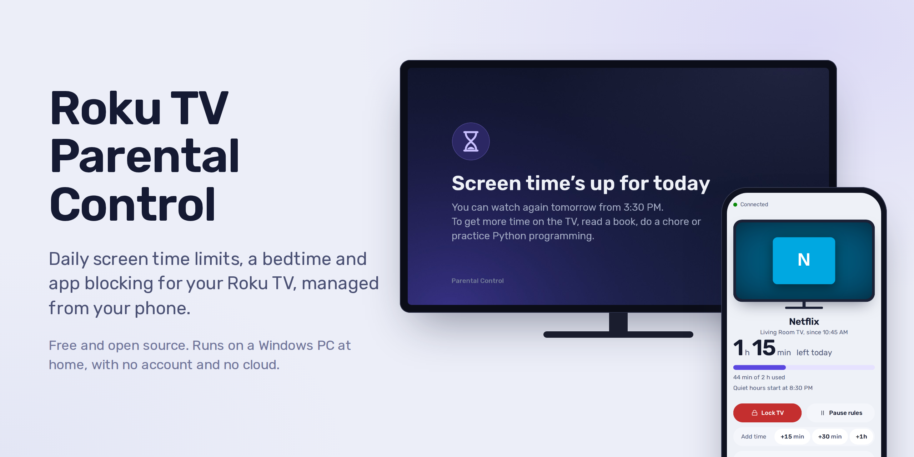
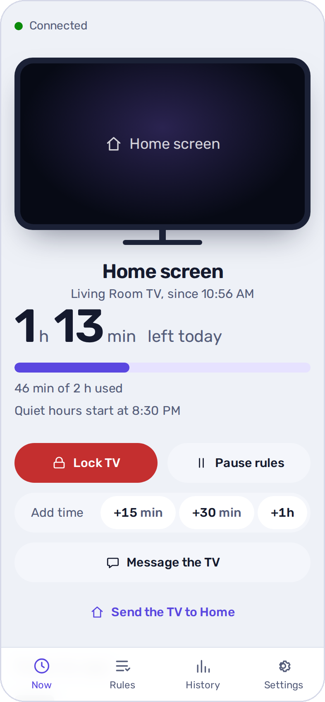
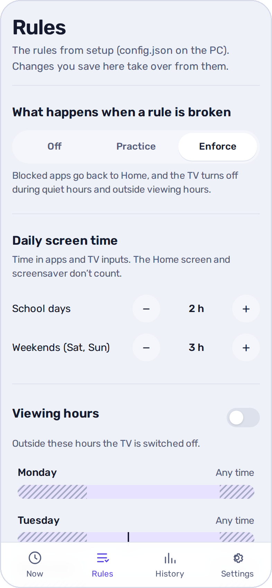
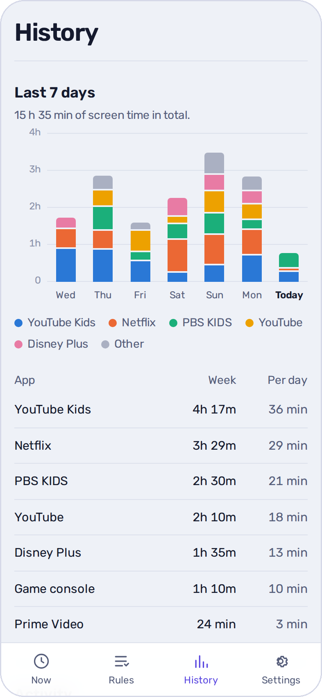
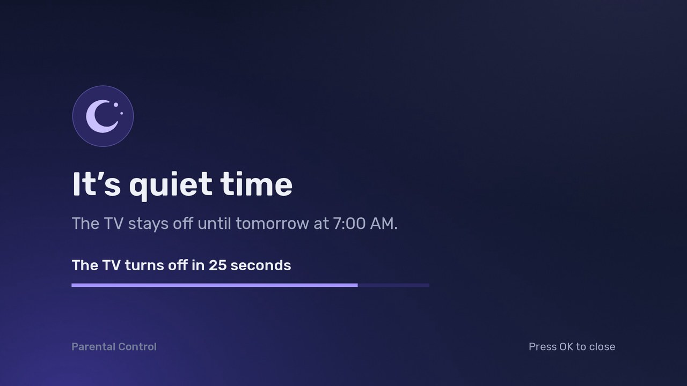
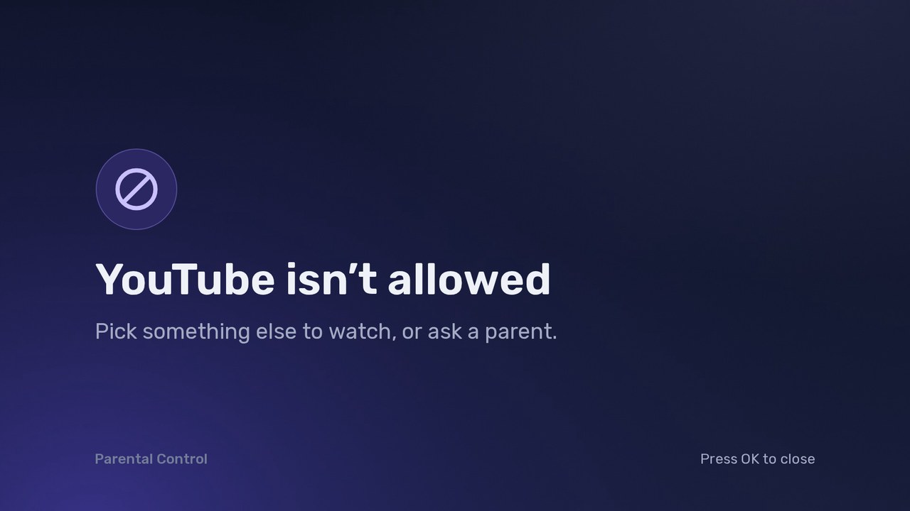
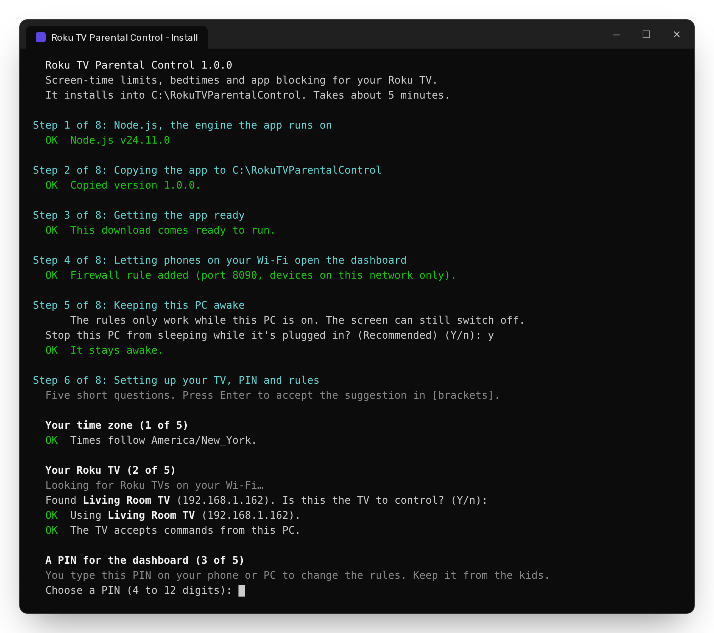
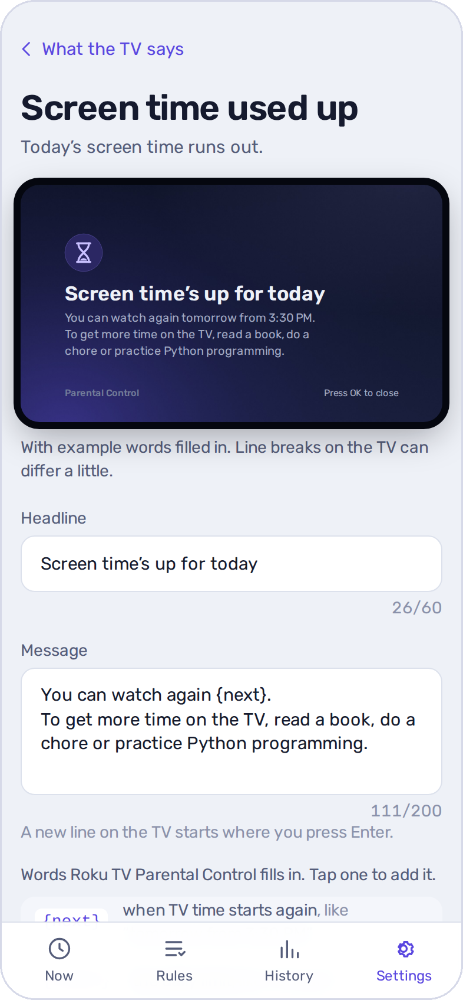

  

# Roku TV Parental Control

**Free screen time limits, a bedtime and app blocking for your Roku TV.** You decide how many hours of TV the kids get each day, when the TV switches off at night, and which apps are allowed, and you manage it all from your phone. It runs on a Windows PC in your home and works with Roku TVs on the same Wi-Fi. There's no subscription and no account, and nothing goes to the cloud.

  

  
  
  

> Roku TV Parental Control is an independent, open-source project. It isn't made, endorsed or supported by Roku, Inc. “Roku” is a trademark of Roku, Inc., used here only to say which TVs it works with.

**Contents:** [What it does](#what-it-does) · [Before you start](#before-you-start) · [Install](#install-it-about-15-minutes) · [Everyday use](#everyday-use) · [Questions](#frequently-asked-questions) · [Troubleshooting](#troubleshooting) · [Update or remove](#update-it) · [Privacy](#privacy)

## Why this exists

Roku's own parental controls are about _what_ can be watched: a PIN for purchases, and ratings filters for The Roku Channel and live TV. As far as we know (October 2026), they don't let you limit _how long_ the TV is on, set a bedtime, or block an app like YouTube. Roku TV Parental Control adds those, using the same Wi-Fi remote-control feature that Roku's own mobile app uses.

## What it does

- **Daily screen time limits**: for example 2 hours on school days and 3 at weekends. When the time is used up, the TV says so and goes back to the Home screen.
- **A bedtime (quiet hours)**: the TV shows a 30-second countdown, then switches itself off. If someone switches it back on, it goes off again.
- **App blocking**: block apps (YouTube, Hulu…) or allow only the ones you choose. Give single apps their own limit, like “YouTube Kids: 45 minutes a day”. Game consoles and other HDMI inputs count too.
- **Viewing hours**: for example, TV only between 3:30 and 7:30 PM on school days.
- **Messages on the TV, in your words**: every rule explains itself on screen (“Screen time’s up for today. To get more time, read a book or do a chore.”). You can also send your own message, like “Dinner’s ready!”.
- **A dashboard on your phone**: what's on now, time left today, the last 7 days. Lock the TV, pause the rules while you watch together, or add 15 minutes as a reward.
- **Practice mode**: try your rules for a day. Nothing is switched off; you see what _would_ have happened.
- **Alerts on your phone** (optional): when a blocked app is opened, when time runs out, or when someone changes the TV's settings to get around the rules.

  
  &nbsp;
  
  &nbsp;
  

  
  

### How it works, in plain words

Roku TVs can be controlled over your home Wi-Fi; that's how the Roku mobile app works as a remote. A small program on your PC uses the same feature. Every few seconds it asks the TV what's on screen and adds up the time. When a rule says so, it presses Home or the power button for you, just as the Roku app would. It runs in the background as a Windows service, so it starts with the PC and works even when nobody is signed in.

## Before you start

You need:

- **A Roku TV**: a TV with Roku built in, from brands like TCL, Hisense, onn., Sharp, Philips, Westinghouse or Element. So far it's been tested on a Hisense Roku TV; please [tell us](../../issues/new/choose) how it works on yours. A Roku streaming stick or box should work for limits and app blocking, but it may not be able to switch the TV off.
- **A Windows 10 or 11 PC that stays on**, at home, on the same network as the TV. An old laptop that stays plugged in is ideal. Wi-Fi or a network cable are both fine, but not a guest network.
- **About 15 minutes**, the TV remote, and your phone.

The installer sets up everything else for you, including the free [Node.js](https://nodejs.org) runtime that the app runs on.

## Install it (about 15 minutes)

### 1. Let the TV be controlled over Wi-Fi

On the TV, with the remote:

1. Press **Home**, then go to **Settings → System → Advanced system settings → Control by mobile apps**.
2. Set **Network access** to **Enabled**. (On some TVs this option is called **Permissive**.)

Also recommended, on Roku TVs: **Settings → System → Power → Fast TV start → On**. Then the app notices straight away when someone switches the TV on.

Why is this needed?

This is the setting that lets apps on your network act as a remote. Since Roku OS 14.1 the default is **Limited**, which lets apps see what's playing but not press buttons, so the rules couldn't be enforced. The installer checks this setting and tells you if it still needs changing.

### 2. Download

[**Download Roku-TV-Parental-Control-Windows.zip**](../../releases/latest/download/Roku-TV-Parental-Control-Windows.zip) (from the [latest release](../../releases/latest)) on the PC that will stay on.

### 3. Extract it

Open your **Downloads** folder, right-click **Roku-TV-Parental-Control-Windows.zip** and choose **Extract All…**, then **Extract**. This takes a minute or two (there are a lot of small files).

> Tip: to avoid the Windows warning in the next step, right-click the zip file _before_ extracting it, choose **Properties**, tick **Unblock** at the bottom and click **OK**.

### 4. Run the installer

In the extracted folder, double-click **Install** (it may show as `Install.cmd`).

- If Windows says **“Windows protected your PC”**, click **More info**, then **Run anyway**. (If it says **“Open File - Security Warning”**, click **Run**.) Windows shows this for any download that isn't signed with a paid certificate. All of the code is here on GitHub for anyone to read.
- When Windows asks **“Do you want to allow this app to make changes to your device?”**, click **Yes**. The installer needs this to add a firewall rule and a background service.

A window opens and works through 8 steps. Most of them need nothing from you:

| Step | What happens                                                                                                                                   |
| ---- | ---------------------------------------------------------------------------------------------------------------------------------------------- |
| 1    | Installs Node.js, the free engine the app runs on, if the PC doesn't have it yet.                                                              |
| 2    | Copies the app to `C:\RokuTVParentalControl`.                                                                                                  |
| 3    | Gets the app ready.                                                                                                                            |
| 4    | Lets phones on your home network open the dashboard (a firewall rule for this network only).                                                   |
| 5    | Asks to stop the PC from sleeping while it's plugged in. Say **yes**: the rules only work while the PC is on. The screen can still switch off. |
| 6    | Asks you five questions (see below).                                                                                                           |
| 7    | Starts it, and makes it start with Windows from now on.                                                                                        |
| 8    | Adds a **Roku TV Parental Control** shortcut to the desktop and the Start menu.                                                                |

  

### 5. Answer five questions

Type your answer and press **Enter**. Just pressing **Enter** accepts the suggestion shown in `[brackets]`.

1. **Your time zone** is taken from the PC.
2. **Your Roku TV**: it looks for the TV on your network. Press Enter when it shows the right one.
   If it says the TV isn't accepting commands yet, go back to [step 1](#1-let-the-tv-be-controlled-over-wi-fi), then press Enter to check again.
3. **A PIN** of 4 to 12 digits, which you'll use to open the dashboard. Nothing appears on screen while you type it. Keep it from the kids.
4. **Rules to start with**: hours of TV on school days and at weekends, bedtime, and the time the TV can come back on in the morning. Then **practice mode**: say **yes** for the first day.
5. **Messages on the TV** (optional, about 3 minutes). Say **yes**, then watch the TV:
   - The installer presses the remote buttons for you, and the TV shows **Developer settings**.
   - Choose **Enable installer and restart**, accept the agreement, and **choose a password**. Write it down.
   - Type that password into the installer window. It waits while the TV restarts.
   - The TV shows **“Parental Control is ready”**. Press **OK** on the remote to close it.

   Developer mode is Roku's official way to add your own channel to a TV. It adds a channel called **Parental Control**, which does nothing except show these messages. Without it, everything still works, but the TV just jumps to the Home screen or switches off without saying why.

When it's done, the dashboard opens in your browser and the window shows a QR code for your phone.

### 6. Open it on your phone

1. Connect the phone to the **same Wi-Fi** as the PC.
2. Point the phone's camera at the QR code in the installer window, and tap the link. (Or type the address shown under the code, something like `http://192.168.1.20:8090`.)
3. Sign in with your PIN.
4. Add it to your home screen so it opens like an app. **iPhone:** tap Share, then **Add to Home Screen**. **Android:** tap ⋮, then **Add to Home screen** (or **Install app**).

To find the QR code again later: **Start menu → Roku TV Parental Control → Open it on a phone**, or **Settings → Use it on your phone** in the dashboard on the PC.

### 7. After a day of practice, turn the rules on

Practice mode only writes down what it would have done. After a day, open **History** in the dashboard and scroll to the activity list to check it did what you expected. Then go to **Rules → What happens when a rule is broken** and choose **Enforce**.

That's it. Roku TV Parental Control now looks after the TV whenever the PC is on. You can delete the downloaded zip file and the extracted folder: the app now lives in `C:\RokuTVParentalControl`.

## Everyday use

**Now** shows what's on the TV and how much screen time is left today. From there you can:

- **Lock TV**: the TV switches off and stays off until you unlock it.
- **Pause rules**: for family movie night. Choose how long; screen time still counts.
- **Add time**: +15 min, +30 min or +1 h, for today only.
- **Message the TV**: type a message, or pick one like “Time for bed”. It can go back to the show afterwards.
- **Send the TV to Home**.

**Rules** is where you change the daily limits, viewing hours, bedtime (quiet hours), which apps are allowed, and daily limits for single apps. Tap **Save rules** when you're done.

**History** shows the last 7 days per app, and everything Roku TV Parental Control has done.

**Settings** has the phone QR code, alerts, your PIN, and **What the TV says**, where you can rewrite every message the TV shows. Words in `{curly brackets}` are filled in for you, like `{next}` for when the TV can be watched again.

  

### Alerts on your phone (optional)

Roku TV Parental Control can send alerts through [ntfy](https://ntfy.sh), a free notification app for iPhone and Android:

1. Install **ntfy** on your phone.
2. In the dashboard, open **Settings → Notifications**, tap **Make a private topic**, switch on **Send notifications** and tap **Save notifications**.
3. In the ntfy app, tap **+** and subscribe to that same topic name.
4. Back in the dashboard, tap **Send a test**.

Choose which alerts you want there: blocked app opened, time's up, TV switched on at night, control blocked (someone changed the TV's settings), and TV unreachable.

## Frequently asked questions

### Does Roku have parental controls?

Yes, but only for content: a PIN for purchases, and ratings filters for The Roku Channel and live TV. At the time of writing, Roku has no daily screen time limit, no bedtime schedule and no way to block a single app like YouTube. That gap is why this project exists.

### How do I set a time limit on a Roku TV?

Install Roku TV Parental Control, and the setup asks how many hours of TV you want on school days and at weekends. You can change them any time in the dashboard under **Rules → Daily screen time**, and give single apps their own limits under **Rules**.

### How do I block YouTube (or any app) on a Roku TV?

In the dashboard, go to **Rules → Apps and inputs**, switch the app off and tap **Save rules**. When someone opens it, the TV shows “YouTube isn’t allowed” and goes back to Home; if they keep trying, the TV switches off. You can also do it the other way round: choose **Allow only some** and switch on just the apps you want.

### Can a Roku TV turn off automatically at bedtime?

Yes. Set a bedtime (quiet hours) in the setup or under **Rules**. At bedtime the TV shows a countdown and switches itself off, and if it's switched back on during quiet hours, it goes off again.

### Does it work with a Roku streaming stick or Roku Express?

Probably for limits and app blocking, but it hasn't been tested yet, and a stick may not be able to switch the TV itself off. It's made for TVs with Roku built in. If you try it on a stick, please [share how it went](../../issues/new/choose).

### Does my PC have to stay on?

Yes, the rules only work while the PC is on and connected to your home network. The installer offers to stop the PC from sleeping while it's plugged in; the screen can still switch off. If the PC restarts (after a Windows update, for example), Roku TV Parental Control starts again by itself. You don't have to sign in.

### Can my kids get around it?

A determined child can, for example by unplugging the PC, or by changing the TV's **Control by mobile apps** setting. You get an alert when the TV stops accepting commands, and the dashboard shows a red warning. To make it harder:

- Set a PIN on your Roku account at [my.roku.com](https://my.roku.com), so channels can't be added without you.
- Keep the PC somewhere out of reach.
- Keep the dashboard PIN to yourself.

### Does it work when I'm away from home?

The rules keep working when you're out, as long as the PC is on. The dashboard only opens on your home network; that's deliberate, for safety. Alerts through ntfy reach your phone anywhere.

### Can it control more than one TV?

Not yet: one TV per PC for now.

### Does it work on a Mac or Linux?

The installer is for Windows only. The app itself is cross-platform, and people comfortable with a terminal can run it on macOS or Linux by following the [developer guide](docs/DEVELOPMENT.md).

### Is it really free? Is it safe?

Yes. It's open source under the MIT license, with no ads, no account and no tracking. See [Privacy](#privacy) for where your data goes.

### Can it filter what's shown inside an app?

No. It decides which apps can be used and for how long, not which videos or shows. For that, use each app's own kids profile (YouTube Kids, Netflix Kids and so on).

## Troubleshooting

**The installer can't find the TV.** Check that the TV is switched on and on the same network as the PC (not a guest network). Then type the TV's IP address when the installer asks; you'll find it on the TV under **Settings → Network → About**.

**“The TV isn't accepting commands from this PC yet.”** Go to **Settings → System → Advanced system settings → Control by mobile apps → Network access** on the TV, and choose **Enabled** (or **Permissive**).

**The phone can't open the dashboard.**

- Make sure the phone is on the same Wi-Fi as the PC, not on mobile data.
- In Windows, the network should be set to **Private**: go to **Settings → Network & internet → Wi-Fi (or Ethernet) → your network → Private network**. The installer offers to do this for you.
- If you have other security software with its own firewall (Norton, McAfee…), allow incoming connections on port 8090 from your home network.

**The dashboard doesn't open on the PC.** Wait a minute after the PC starts, then try again. If it still doesn't open, restart the PC. If that doesn't help either, [open an issue](../../issues/new/choose) and attach `C:\RokuTVParentalControl\logs\service\launcher.log`.

**I forgot the PIN.** Run **Start menu → Roku TV Parental Control → Run setup again** and answer **n** to “A PIN is already set. Keep it?”.

**The messages stopped showing on the TV.** A sideloaded channel can disappear after a TV update or reset. Run **Start menu → Roku TV Parental Control → Run setup again** and say **yes** to the messages step.

**I forgot the TV's developer password.** Open **Developer settings** on the TV again (Home three times, Up twice, then Right, Left, Right, Left, Right), choose **Disable installer**, then run setup again and choose a new password.

**I got a new TV or a new router.** Run **Start menu → Roku TV Parental Control → Run setup again**. Your rules and history are kept.

**Something else?** [Open an issue](../../issues/new/choose) and describe what happened, including any message the installer window showed.

## Update it

Download the latest zip, extract it and run **Install** again. Your rules, PIN and history are kept.

## Remove it

**Start menu → Roku TV Parental Control → Uninstall Roku TV Parental Control.** It asks whether to keep your settings and history. Nothing on the TV is changed. Afterwards you can switch the TV's **Control by mobile apps** back to how it was, and turn off developer mode (the same remote buttons, then **Disable installer**).

## Privacy

- **Everything stays in your home.** There's no account and no cloud service. Screen time history is stored only on your PC, in `C:\RokuTVParentalControl\data`.
- **The dashboard only opens from your home network**, and needs your PIN. Never forward port 8090 on your router.
- **Alerts are optional.** If you switch them on, they're sent through ntfy.sh (or your own ntfy server) and contain only the alert text. Use a long, random topic name: the dashboard makes one for you.
- **Talking to the TV** happens on your home network only, the same way the Roku mobile app does.

## Helping out

Bug reports, TV models that work (or don't), translations and code are all welcome.

- [Report a problem or share your TV model](../../issues/new/choose)
- [Contributing guide](CONTRIBUTING.md)
- [Developer and power-user guide](docs/DEVELOPMENT.md): running it from source, the configuration file, the mock TV for testing, and how it's built (Node.js, TypeScript, SQLite, React and a small BrightScript channel)

## License

[MIT](LICENSE). Use it, change it and share it freely.

Roku TV Parental Control is not affiliated with, endorsed by or sponsored by Roku, Inc. Roku, Roku TV and the Roku logo are trademarks of Roku, Inc. Other product names are trademarks of their owners and are mentioned only to describe compatibility.
